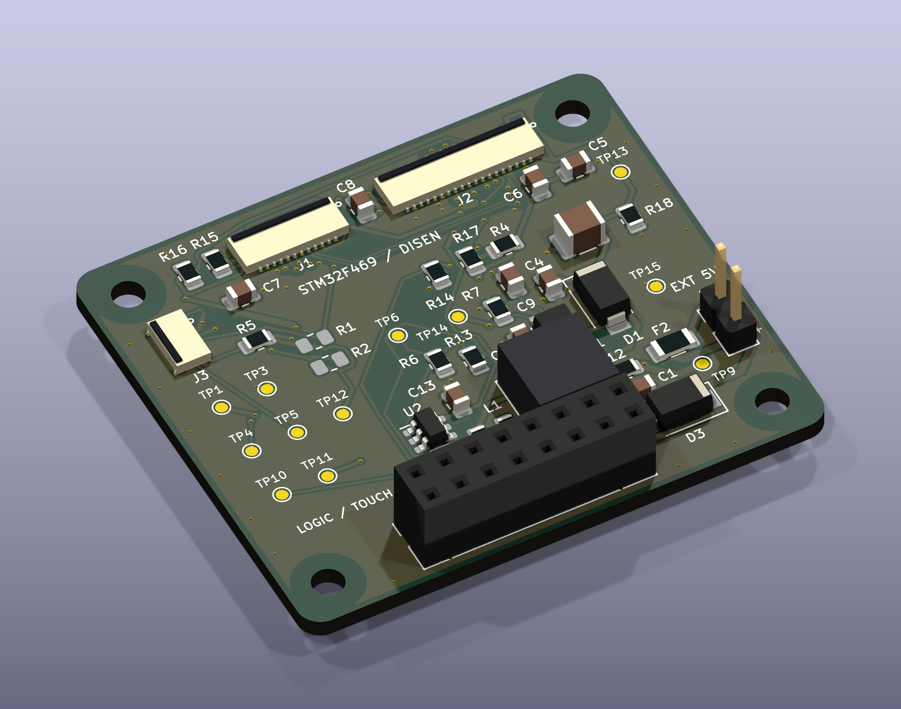

# STM32F469 / DISEN — Rev I · Routing R1

**Routing tamamlandı: 0 DRC ihlali, 0 açık bağlantı, 0 şematik eşleşme sorunu, 0 ERC ihlali.** Onaylanan şematik ve komponent yerleşimi korunmuştur.

- [Tüm native proje, görseller ve üretim çıktıları — ZIP](STM32F469_RevI_Routed_Review.zip)
- [Kısa routing inceleme raporu — PDF](PCB_Routing_Review/Routing_Review_TR.pdf)
- [Düzenlenebilir KiCad PCB projesi](PCB_Routing_Review/Project/)
- [Katmanlar, kurallar ve mühendislik değerlendirmesi](PCB_Routing_Review/Engineering/ENGINEERING_REVIEW_TR.md)
- [DRC sonucu](PCB_Routing_Review/Verification/DRC.txt) · [Gerber/drill denetimi](PCB_Routing_Review/Verification/manufacturing_audit.json)

46 × 40 mm, dört bakır katman, nominal 1,6 mm; iki iç GND referansı. 49 devre footprint’i + dört NPTH montaj deliği. ZIP’i tamamen çıkarıp `PCB_Routing_Review/Project/STM32F469_DISEN_RevI.kicad_pro` dosyasını KiCad 9 ile açın. Dosya sayfasındaki **Download raw file** simgesi ZIP’i indirir; **Code → Download ZIP** tüm depoyu indirir.

Bu teslim üretim öncesi mühendislik incelemesidir. Üretici stackup’ı/empedans toleransı ve FPC–flex mekanik eşleşmesi henüz onaylı değildir. Empedans hesabı nominaldir. FPC ve L1 3D gövdeleri nominal hacimlerdir. Açık bilgiler ve hesap sınırları raporda belirtilmiştir.

## Korunan önceki teslimler

- [Onaylanan komponent yerleşimi P1](PCB_Placement_Review/Placement_Review.pdf) · [Yerleşim arşivi](STM32F469_RevI_Placement_Review.zip)
- [Onaylanan şematik PDF](STM32F469_RevI_Professional.pdf) · [Şematik KiCad arşivi](STM32F469_RevI_Professional_KiCad.zip)
- [Şematik kaynak projesi](STM32F469_DISEN_RevI_Layout/)

Önceki teslimler değiştirilmedi. Routing projesindeki şematikler onaylanan şematik dosyalarının birebir kopyalarıdır.
