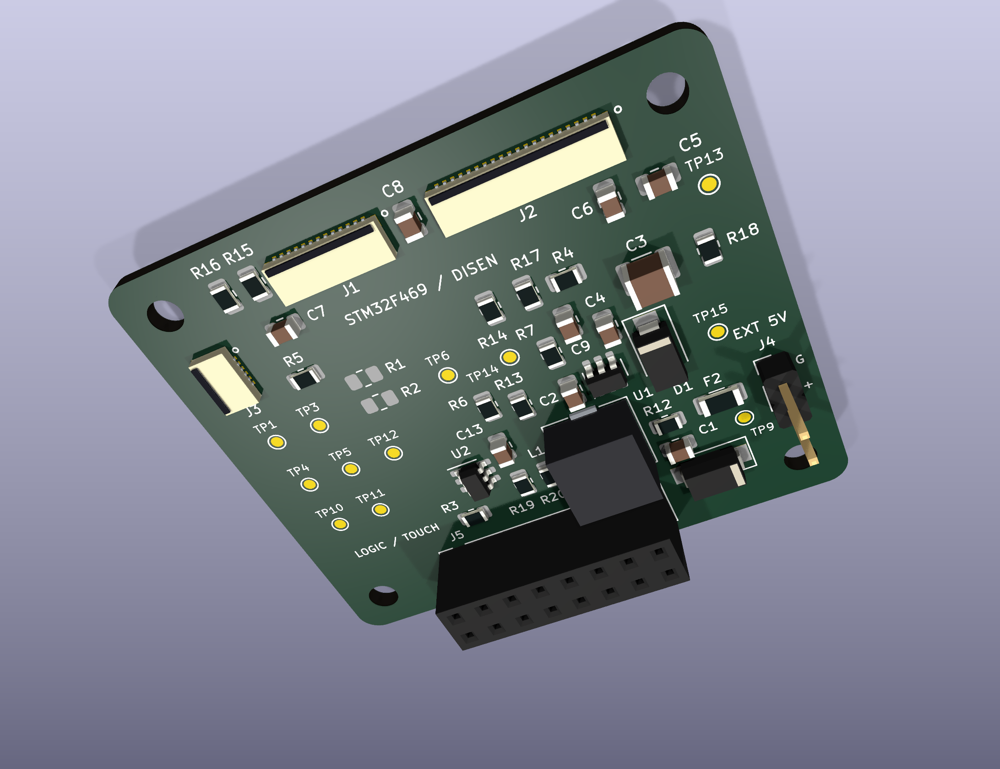

# STM32F469 / DISEN — PCB Yerleşimi P1

**46 × 40 mm, 4 katmanlı, bağımsız kablolu adaptörün komponent yerleşimi incelemeye hazır. Routing henüz yapılmadı.**

- [Yerleşim incelemesi ve üst/alt/3D görünümler — PDF](PCB_Placement_Review/Placement_Review.pdf)
- [Tam KiCad PCB proje paketi — ZIP](STM32F469_RevI_Placement_Review.zip)
- [Düzenlenebilir proje klasörü](PCB_Placement_Review/Project/)
- [Mühendislik değerlendirmesi ve doğrulama sınırları](PCB_Placement_Review/README_TR.md)
- [DRC ve bağlantı denetimi](PCB_Placement_Review/Verification/placement_audit.json)

ZIP'i çıkarıp `PCB_Placement_Review/Project/STM32F469_DISEN_RevI.kicad_pro` dosyasını **KiCad 9** ile açın. İndirmek için dosya sayfasındaki **Download raw file** simgesini veya **Code → Download ZIP** yolunu kullanın.

49 devre footprint'i, 4 mekanik delik, 57 net ve 172 pin/net üyeliği korunmuştur. Yerleşim DRC'si 0 ihlal, schematic parity 0 sorun; **115 açık bağlantı**, routing yapılmadığı için beklenir. İz/via/zone sayıları 0'dır. Kullanıcı onayından önce routing aşamasına geçilmedi.

FPC kontakt/aktüatör ve gerçek flex eşleşmesi üretici çizimleri/fiziksel parça ile teyit bekler. FPC ve L1 3D gövdeleri nominal hacim modelleridir; üretici STEP'i değildir. Ayrıntılar değerlendirme raporundadır.

## Onaylı şematik — Rev I / Layout 1

- [Düzenlenmiş şematik PDF](STM32F469_RevI_Professional.pdf)
- [Şematik KiCad ZIP paketi](STM32F469_RevI_Professional_KiCad.zip)
- [Şematik kaynak projesi](STM32F469_DISEN_RevI_Layout/)

Onaylı şematik projesi ayrı korunmuştur; PCB projesindeki şematikler aynı dosyaların birebir kopyalarıdır.
