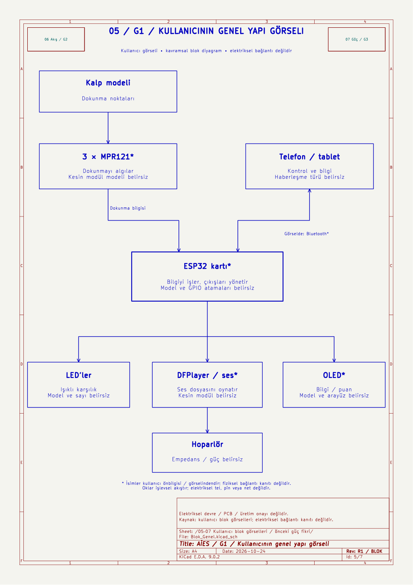
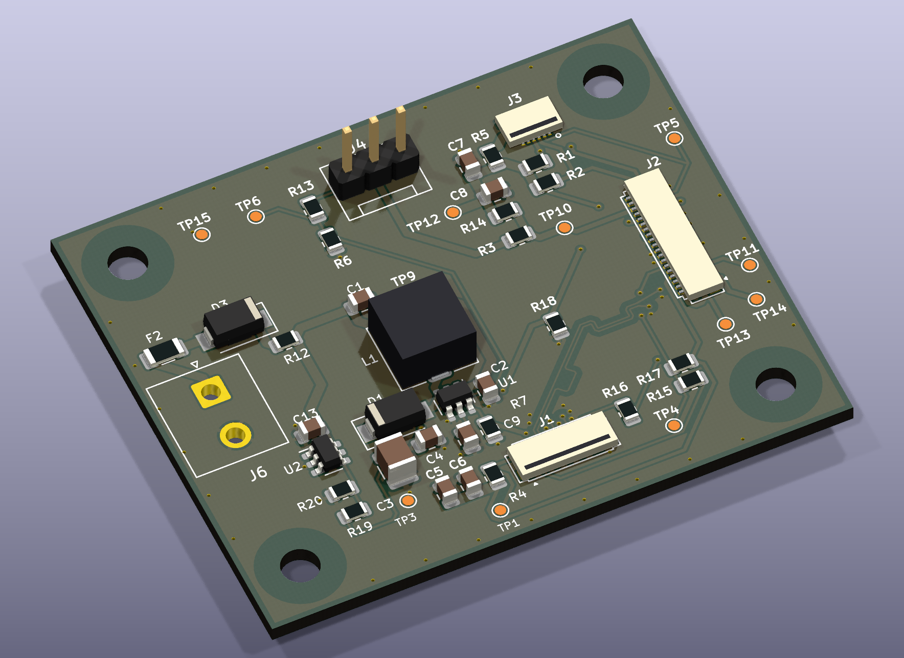
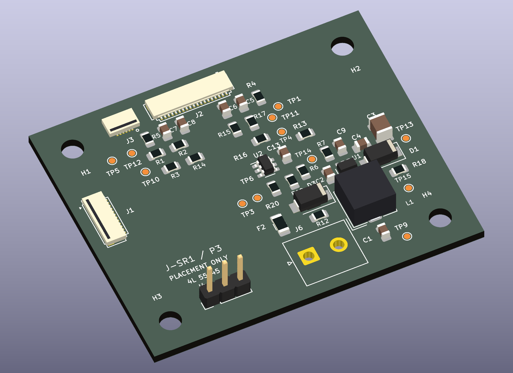
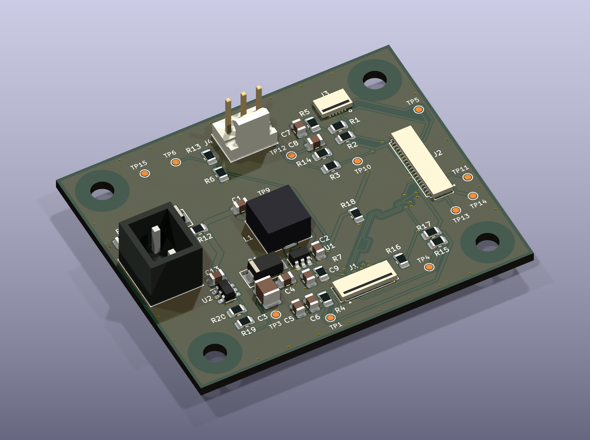
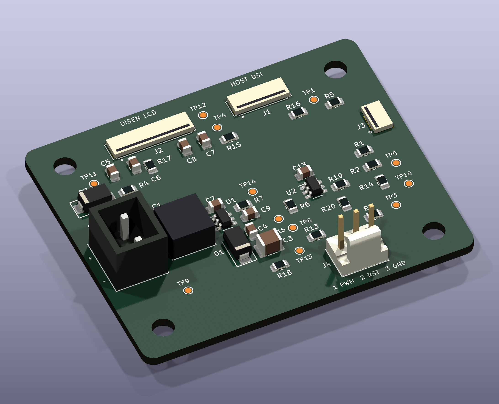
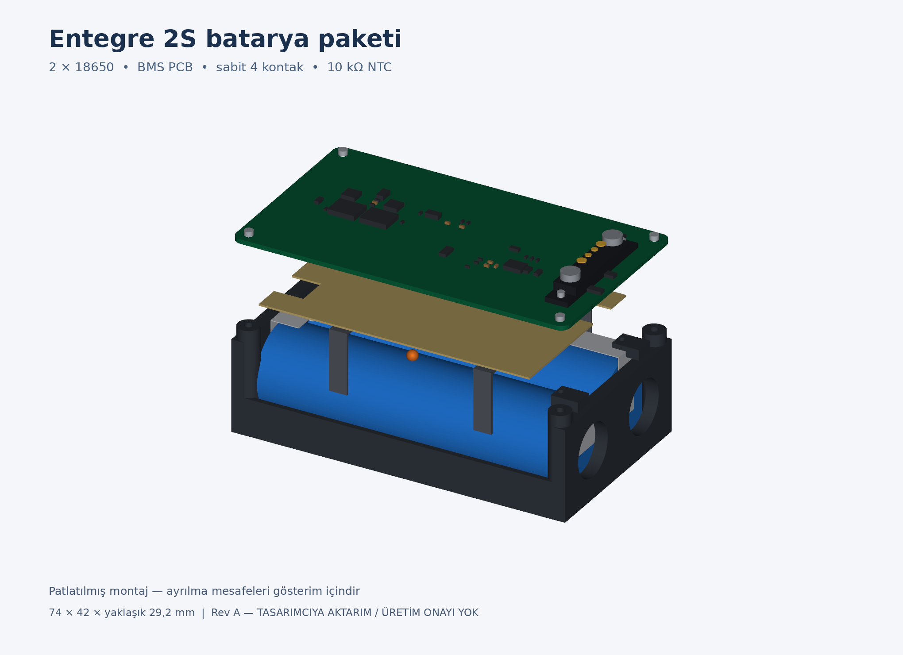
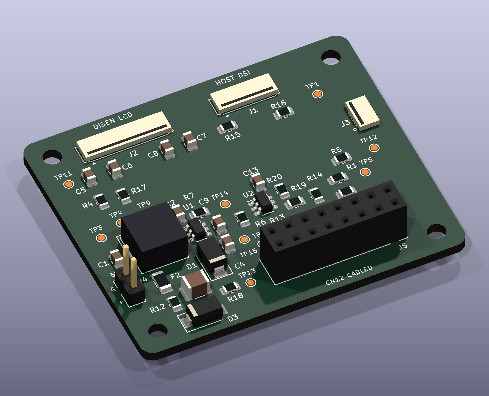
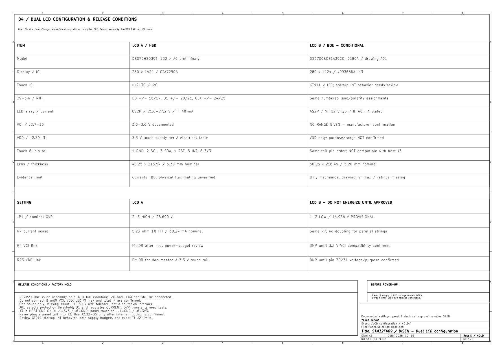

# AİES — kalp anatomi eğitim cihazı

**Güncel teslim:** videodan gözlem kaydı ve ayrı bir bağlantı önerisi; paylaşılan üç blok görseli KiCad sayfaları olarak da oluşturuldu.

- [Tüm KiCad projeleri, PDF, parça/GPIO tabloları ve video kanıtları — ZIP](AIES_Kalp_Anatomi_KiCad_Rev1.zip)
- [Bağlantı önerisi P1 — 7 sayfalı PDF](AIES_Video_Schematic_Review_R1/PDF/AIES_Oneri_P1.pdf)
- [Video inceleme raporu ve yakın görüntüler — PDF](AIES_Video_Schematic_Review_R1/PDF/Inceleme_Raporu_TR.pdf)
- [Açılış ve kapsam](AIES_Video_Schematic_Review_R1/README_TR.md) · [Zaman/kesinlik tablosu](AIES_Video_Schematic_Review_R1/Review/Inceleme_Tablosu.csv)

Öneri projesini `AIES_Video_Schematic_Review_R1/Proposal/Project/AIES_Oneri_P1.kicad_pro` ile KiCad 9'da açın. **P1 ERC: 0 hata / 0 uyarı; 157 pin–net eşlemesi kontrol edildi.** GPIO/adres/LED sırası mühendislik seçimidir; mevcut yüklü firmware uyumu bilinmiyor, uyarlama gerektirir.

`Project/` altındaki video kaydı ayrı tutuldu: bilinmeyen kablolar/GPIO tahmin edilmedi; 68 açık terminal + 8 besleme-sürücü ERC bulgusu saklanmadı. Küçük video 148,89 saniye / 480×848; 3 × 8 görünür LED gövdesi sayıldı. Ses konuşması incelenemedi. Exact modül, güç/USB ve üretici limitleri açık; PCB/firmware veya fiziksel test yapılmadı. Üretime hazır onayı verilmedi.

---

# Güncel teslim — Rev J / Routing R2

**Güncel yüklenen Project.zip temel alınarak routing tamamlandı. 0 DRC ihlali / 0 açık bağlantı / 0 şematik–PCB farkı / ERC 0 hata ve 0 uyarı.**

- [Doğrudan indir — KiCad + Gerber/drill + rapor ZIP](https://github.com/yakuptrkn42-create/ai_pcb_design/raw/refs/heads/main/STM32F469_DISEN_RevJ_Routing_R2.zip)
- [Yalnız üreticiye aktarım dosyaları — CAM ZIP](https://github.com/yakuptrkn42-create/ai_pcb_design/raw/refs/heads/main/STM32F469_DISEN_RevJ_Routing_R2_Fabrication.zip)
- [Beş sayfalık teknik rapor — PDF](SingleLCD_RevJ_Routing_R2/PDF/Routing_R2_Review_TR.pdf)
- [Düzenlenebilir KiCad projesi](SingleLCD_RevJ_Routing_R2/Project/) · [Açılış ve kapsam](SingleLCD_RevJ_Routing_R2/README_TR.md)
- [Gerber/drill doğrulaması](SingleLCD_RevJ_Routing_R2/Verification/Manufacturing_Audit.json) · [Bağımsız elektriksel/routing denetimi](SingleLCD_RevJ_Routing_R2/Verification/Validation_Summary.json)

55 × 45 mm / dört katman; J1/J2/J3 ve dört montaj deliği aynı konumda. DSI iletkenleri ~32,824 mm, her birinde iki via; çift içi planar fark <0,001 mm. İki iç GND düzlemi, backlight güç/Kelvin yolları ve eksik kontrol/besleme bağlantıları tamamlandı. SW dal toplamı 5,54 mm / 0,6 mm; 5 V ana yolları 0,8 mm. R13 8,2k/%1; J6 polarite yazısı düzeltildi. Kaynak 159 pin–net üyeliği korunur.

**Üretim kabulü koşullu:** 100 Ω hedefi için 99,4 Ω maskesiz 2D tahmin nominal kesite aittir; gerçek üretici kesiti/bitmiş geometri ve empedans kabulü henüz doğrulanmadı. FPC/kasa, parça rating'leri, touch gerilim toleransı ve yük/OVP/SI testleri raporda açıktır. Gerber/drill hazırlanmış olması fiziksel çalışma garantisi değildir. CAM ZIP içindeki aktarım koşulları imalat öncesi uygulanmalıdır.

ZIP'i tamamen çıkarıp `SingleLCD_RevJ_Routing_R2/Project/STM32F469_DISEN_RevJ_Prep1.kicad_pro` dosyasını KiCad 9 ile açın. Aşağıdaki teslimler tarihsel olarak korunur; güncel R2 projesiyle karıştırılmamalıdır.

---

# Korunan PCB yerleşimi — J-SR1 / Placement P3

**Placement tamamlandı; routing yapılmadı.** Son J-SR1 şematiği korunarak 55 × 45 mm / dört katmanlı kart yeniden yerleştirildi. J1 sol, J2/J3 üst kenara alındı; DSI için açık L koridoru ve sağ altta kompakt TPS61165 bloğu oluşturuldu. Dört montaj deliği aynı konumda kaldı.

- [Doğrudan indir — P3 KiCad ZIP](https://github.com/yakuptrkn42-create/ai_pcb_design/raw/refs/heads/main/STM32F469_DISEN_RevJ_Placement_P3.zip)
- [Yerleşim incelemesi — dört sayfalık PDF](SingleLCD_RevJ_Placement_P3/PDF/Placement_P3_Review_TR.pdf)
- [Düzenlenebilir KiCad projesi](SingleLCD_RevJ_Placement_P3/Project/) · [Açılış ve kapsam](SingleLCD_RevJ_Placement_P3/README_TR.md)
- [Routing alanı ve via adayları](SingleLCD_RevJ_Placement_P3/Views/Routing_Plan.png) · [Routing devir notları](SingleLCD_RevJ_Placement_P3/Engineering/ROUTING_HANDOFF_TR.md)
- [Doğrulama özeti](SingleLCD_RevJ_Placement_P3/Verification/Validation_Summary.json) · [Taşınabilir proje kontrolü](SingleLCD_RevJ_Placement_P3/Verification/Portable_Check.json)

**0 fiziksel DRC ihlali / 0 parity farkı / ERC 0 hata ve 0 uyarı.** Kartta 0 iz, 0 via ve 0 bakır dolgu var; montaj donanımı için dört keepout/rule area var. Routing yapılmadığı için 115 bağlantısız öğe kaydı beklenir. Üç şematik dosyası byte düzeyinde değişmedi; komponent değerleri, footprint kimlikleri ve pin bağlantıları J-SR1 ile eşleşir.

100 Ω ve iz/skew/via bütçeleri tasarım hedefleridir; üretici stackup'ı ve gerçek routing ile doğrulanmalıdır. İç GND katmanları henüz boş. FPC modelleri nominal; J6 gövdesinin 3D modeli yok. Exact kablo/kasa uyumu fiziksel teyit gerektirir. Bu paket üretim çıktısı değildir; aşağıdaki eski routing teslimleri P3'e uygulanmaz.

ZIP'i tamamen çıkarıp `SingleLCD_RevJ_Placement_P3/Project/STM32F469_DISEN_RevJ_Prep1.kicad_pro` dosyasını KiCad 9 ile açın.

---

# Yeni şematik inceleme — J-SR1

- [KiCad proje paketini indir — ZIP](STM32F469_DISEN_J_SR1_Schematic_Review.zip?raw=true)
- [Revize şematik — PDF](Schematic_RevJ_SR1_Review/PDF/Schematic_J_SR1.pdf)
- [Beş sayfalık teknik rapor — PDF](Schematic_RevJ_SR1_Review/PDF/Engineering_Review_TR.pdf)
- [Native KiCad projesi ve açılış notları](Schematic_RevJ_SR1_Review/README_TR.md)

22 Ekim 2026 tarihinde yüklenen proje üzerinde elektriksel şematik incelemesi: **ERC 0 hata / 0 uyarı**. J6 polarite açıklaması ve J4 konnektör/footprint tanımı düzeltildi; R13 8,2 kΩ yapıldı. 39 LCD pini, 25 host CN10 pini ve 53 footprint'in pin üyeliği doğrulandı. Kaynak ZIP değiştirilmeden paketlendi.

**Koşullu teslim:** host 3,365 V toleransı / touch 3,3 V üst sınırı için DISEN teyidi; gerçek FPC sürekliliği ve OVP açık-yük testleri bekleniyor. Donanımda çalışma ve nihai PCB dondurma onayı verilmedi. Bu revizyon şematik içindir; aşağıdaki önceki routing teslimi güncellenmedi.

---

# DISEN LCD — Rev J / Routing R1

**Güncel teslim: dört katman routing tamamlandı. 0 DRC ihlali / 0 bağlantısız öğe / 0 şematik–PCB parity farkı.**

- [Tek ZIP — KiCad proje, 2D/3D, rapor, Gerber ve drill](STM32F469_DISEN_RevJ_Routing_R1.zip)
- [Kısa mühendislik raporu ve PCB görselleri — PDF](SingleLCD_RevJ_Routing_R1/PDF/Routing_R1_Review_TR.pdf)
- [Native KiCad projesi](SingleLCD_RevJ_Routing_R1/Project/) · [Açılış ve doğrulama notları](SingleLCD_RevJ_Routing_R1/README_TR.md)
- [Final DRC](SingleLCD_RevJ_Routing_R1/Verification/DRC_Final.txt) · [Stackup / kurallar](SingleLCD_RevJ_Routing_R1/Engineering/Stackup_And_Rules_TR.md) · [CAM doğrulaması](SingleLCD_RevJ_Routing_R1/Verification/Manufacturing_Audit.json)

55 × 45 mm, nominal 1,6 mm / dört katman. J1/J2 ana konnektörleri aynı konum/yönde; şematik netler ve değerler korundu. 5 V yolları 0,8 mm; DSI iletkenleri iki via ile ~32,824 mm, çift içi fiziksel fark <0,01 mm. 49 devre referansı / 44 net / 159 pad–net üyeliği. ERC 0 hata / 3 mevcut etiket uyarısı. Yerleşim değişiklikleri raporda ve CSV/JSON dosyalarında açıklandı.

**Üretici henüz seçilmedi:** stackup/100 Ω hedefi nominaldir; üretici empedans teyidi ve rapordaki FPC/parça/OVP koşulları kapanmalıdır. Gerber/drill son mühendislik incelemesi içindir; fiziksel çalışma garantisi verilmez. Orijinal yüklenen ZIP korundu; önceki projeler ayrı duruyor.

ZIP'i tamamen çıkarıp `SingleLCD_RevJ_Routing_R1/Project/STM32F469_DISEN_RevJ_Prep1.kicad_pro` dosyasını KiCad 9 ile açın. GitHub ZIP sayfasındaki **Download raw file** düğmesiyle indirebilirsiniz.

---

# Korunan önceki placement — Rev J P2

**Önceki LCD teslimi:** yeni yüklenen Project.zip üzerinde son şematik kontrolü ve dört katmanlı placement optimizasyonu.

- [Tek ZIP — tüm proje dosyaları](STM32F469_DISEN_RevJ_Placement_P2.zip)
- [Kısa değerlendirme ve PCB görselleri — PDF](SingleLCD_RevJ_Placement_P2/PDF/Placement_P2_Review_TR.pdf)
- [Güncel şematik — PDF](SingleLCD_RevJ_Placement_P2/PDF/STM32F469_DISEN_RevJ_Placement_P2.pdf)
- [Native KiCad projesi](SingleLCD_RevJ_Placement_P2/Project/) · [Açılış notları](SingleLCD_RevJ_Placement_P2/README_TR.md)

55 × 45 mm, nominal 1,6 mm / dört katman; 49 devre referansı ve kullanıcının dört Ø3,5 mm montaj deliği. J6'nın yanlış polarite açıklaması **1=+5V / 2=GND** olarak düzeltildi; J4 üç kablolu PWM/reset/GND arayüzü doğru adlandırıldı. Elektriksel netler değişmedi: 44 net / 159 pin–net üyeliği aynı. Dokuz kart dışı test noktası içeri alındı; üç konnektör yaklaşımı karşılaştırıldı, ortak DSI kenarı ve kısa boost döngüleri seçildi.

**0 iz / 0 via / 0 zone.** ERC 0 hata / 3 mevcut uyarı; fiziksel DRC 0; şema–PCB parity 0. Routing yapılmadığından 115 bağlantısız öğe kaydı açık. Stackup/empedans ve FPC exact mekanik teyitleri raporda açık; üretim kabulü verilmedi. Routing ayrı onay bekler.

ZIP'i tamamen çıkarın ve `SingleLCD_RevJ_Placement_P2/Project/STM32F469_DISEN_RevJ_Prep1.kicad_pro` dosyasını KiCad 9 ile açın. Kaynak basename korunmuş, başlıklar Placement P2 yapılmıştır. GitHub ZIP sayfasındaki **Download raw file** düğmesini kullanabilirsiniz.

---

## Entegre 2S batarya paketi — Rev A

İnfüzyon pompası için iki adet 18650 hücre, BMS ve sabit dört kontaklı dock bağlantısını birleştiren **tasarımcıya aktarım ön tasarımı**.

- [Tüm proje paketi — ZIP](Integrated_Battery_Pack_RevA.zip)
- [Görsel tasarım raporu — PDF](Integrated_Battery_Pack_RevA/Tasarimciya_Aktarim_TR.pdf)
- [KiCad proje dosyaları](Integrated_Battery_Pack_RevA/Project/)
- [STEP / WRL / FreeCAD montajı](Integrated_Battery_Pack_RevA/Mechanical/)
- [Kapsam ve açılış notları](Integrated_Battery_Pack_RevA/README_TR.md)

Nominal 7,4 V / 3500 mAh; yaklaşık 2 A hedefi; 74 × 42 × 29,12 mm nominal montaj zarfı. Kaynak şematik boş olduğundan bağlantılar PCB'den geri kazanıldı. ERC, fiziksel DRC, açık bağlantı ve şema–PCB eşleşme kontrolleri temizdir; IC işlevleri ve BMS ayarları henüz doğrulanmamıştır. **Üretim veya klinik kullanım onayı yoktur.** Kesin hücre, NTC/host uyumu ve fiziksel numune testleri tasarımcı tarafından tamamlanmalıdır.

---

# STM32F469I-DISCO / DISEN — Rev J komponent yerleşimi

**Korunan önceki teslim: DS070HSD39T-132 için Placement P1.** Onaylı tek LCD şematiği korunarak 49 devre footprint’i yerleştirildi. Çift LCD Rev K ayrı korunuyor.

- [Yerleşim teslimatı — ZIP](STM32F469_DISEN_RevJ_Placement_P1.zip)
- [Yerleşim incelemesi — PDF](SingleLCD_RevJ_Placement_P1/PDF/Placement_Review_TR.pdf)
- [Native KiCad projesi](SingleLCD_RevJ_Placement_P1/Project/)
- [Açılış ve kapsam](SingleLCD_RevJ_Placement_P1/README_TR.md)

50 × 42 mm, R2 köşe, nominal 1,6 mm / 4 katman, üst yüz montajı; dört Ø2,7 mm bağlantısız M2.5 montaj deliği. Üç yerleşim yaklaşımı karşılaştırıldı, routing/SI düzeni seçildi ve yeniden iyileştirildi. Şematik, değerler, 57 net / 172 pin–net üyeliği ve mevcut kurallar korundu.

**0 iz / 0 via / 0 zone.** Yerleşim DRC’si 0 fiziksel ihlal, şema–PCB parity 0 fark; routing yapılmadığından 115 bağlantısız öğe kaydı açıktır. ERC 0 hata / 3 mevcut uyarı. Routing, yerleşim onayını bekler. FPC modelleri nominal; exact kontak/latch/kablo ve üretici stackup/empedans teyitleri raporda açıktır.

ZIP’i tamamen çıkarıp `SingleLCD_RevJ_Placement_P1/Project/STM32F469_DISEN_RevJ_Prep1.kicad_pro` dosyasını KiCad 9 ile açın. Onaylı şematiği byte düzeyinde korumak için kaynak basename korunmuştur. GitHub ZIP sayfasında **Download raw file** kullanılabilir.

## Korunan tek LCD PCB hazırlığı

**Güncel çalışma: DS070HSD39T-132 için Rev J / PCB Hazırlık 1.** Yüklenen eski Rev J esas alındı; çift LCD Rev K ayrı korunuyor.

- [Tek LCD hazırlık teslimatı — ZIP](STM32F469_DISEN_RevJ_PCBPrep1.zip)
- [KiCad proje ve kütüphaneleri](SingleLCD_RevJ_PCBPrep/Project/)
- [Doğrulama raporu — PDF](SingleLCD_RevJ_PCBPrep/PDF/Validation_RevJ_Prep1_TR.pdf)
- [Şematik — PDF](SingleLCD_RevJ_PCBPrep/PDF/STM32F469_DISEN_RevJ_Prep1.pdf)
- [Açılış ve kapsam](SingleLCD_RevJ_PCBPrep/README_TR.md)

49 footprint, 57 net ve 49 model bağı; 172 pin/net kontrolü; şema–PCB parity **0 fark**, ERC **0 hata / 3 açıklanmış uyarı**. Elektriksel bağlantılar ve değerler Rev J ile aynıdır. 4 katmanlı nominal stackup ve routing kuralları kaydedildi.

**Yerleşim henüz yapılmadı:** komponentler başlangıç aktarımı olarak (0,0)'da üst üste durur. Kart sınırı, iz, via ve dolgu yoktur. Bu aşamanın DRC çakışmaları gizlenmeden paketlendi; üretim kabulü verilmedi. FPC ve endüktör modelleri nominaldir; exact mekanik/panel/OVP ve üretici stackup koşulları raporda açıktır. Model kontrol panosu görüntüleri adaptör yerleşimi değildir.

ZIP'i tamamen çıkarıp `SingleLCD_RevJ_PCBPrep/Project/STM32F469_DISEN_RevJ_Prep1.kicad_pro` dosyasını KiCad 9 ile açın. GitHub ZIP sayfasındaki **Download raw file** düğmesiyle indirebilirsiniz.

# Korunan çift LCD çalışması — Rev K

**Güncel teslim: ortak 39 pinli donanım ve seçilebilir backlight OVP şematiği.** LCD-A: DS070HSD39T-132; LCD-B: DS0700BOE1A39CO-0180A.

- [Tüm Rev K dosyaları — ZIP](STM32F469_DISEN_RevK_DualLCD_Review.zip)
- [Gerçek şematik, 4 sayfa — PDF](Schematic_RevK_DualLCD/PDF/STM32F469_DISEN_RevK_DualLCD.pdf)
- [Türkçe mühendislik incelemesi — PDF](Schematic_RevK_DualLCD/PDF/Dual_LCD_Engineering_Review_TR.pdf)
- [Açılış, karşılaştırma ve montaj tablosu](Schematic_RevK_DualLCD/README_TR.md)
- [Native KiCad projesi](Schematic_RevK_DualLCD/Project/) · [BOM](Schematic_RevK_DualLCD/BOM/BOM_RevK_FACTORY_HOLD.csv) · [ERC](Schematic_RevK_DualLCD/Verification/ERC_RevK.txt)

**Yeni LCD için yalnızca mekanik çizim mevcut; tam elektriksel uyumluluk onayı verilmedi.** VCI/VDD gerilim aralıkları ve maksimum LED değerleri eksiktir. Varsayılan R4/R23 DNP montajı bir onay bekletme durumudur; tam izolasyon değildir. Panel-B, eksik veriler kapanmadan bağlanıp enerjilendirilmemelidir.

R7 her iki panel için 5,23 Ω / nominal 38,24 mA kaldı. JP1 yalnızca OVP eşiğini seçer: A 2–3 HIGH ≈28,69 V; B 1–2 LOW ≈14,94 V (geçici aday). MIPI yollarına anahtar eklenmedi. ERC: **0 hata / 3 açıklanmış uyarı**; kurallar değiştirilmedi. PCB ve yazılım bu aşamada değiştirilmedi. Eski PCB'ler yeni dört footprint ve bağlantılar için ECO gerektirir.

ZIP'i tamamen çıkarıp `Schematic_RevK_DualLCD/Project/STM32F469_DISEN_RevK.kicad_pro` dosyasını KiCad 9 ile açın. GitHub ZIP sayfasındaki **Download raw file** düğmesi dosyayı indirir. Yüklenen Rev J arşivi teslimin Original klasöründe aynen korunmuştur.

## Korunan önceki teslimler

- [Rev J şematik ZIP](STM32F469_DISEN_RevJ_Schematic_Review.zip) · [Rev J incelemesi](Schematic_RevJ_Review/README_TR.md)
- [Rev I routing ZIP](STM32F469_RevI_Routed_Review.zip) · [Routing incelemesi](PCB_Routing_Review/Routing_Review_TR.pdf)
- [Rev I placement](PCB_Placement_Review/Placement_Review.pdf) · [Placement ZIP](STM32F469_RevI_Placement_Review.zip)
- [Rev I şematik PDF](STM32F469_RevI_Professional.pdf) · [Şematik KiCad arşivi](STM32F469_RevI_Professional_KiCad.zip)

Tarihsel dosyalar değiştirilmedi; Rev K'nin yeni devresini içermezler. Önceki Gerber'ler Rev K üretim çıktısı değildir.
