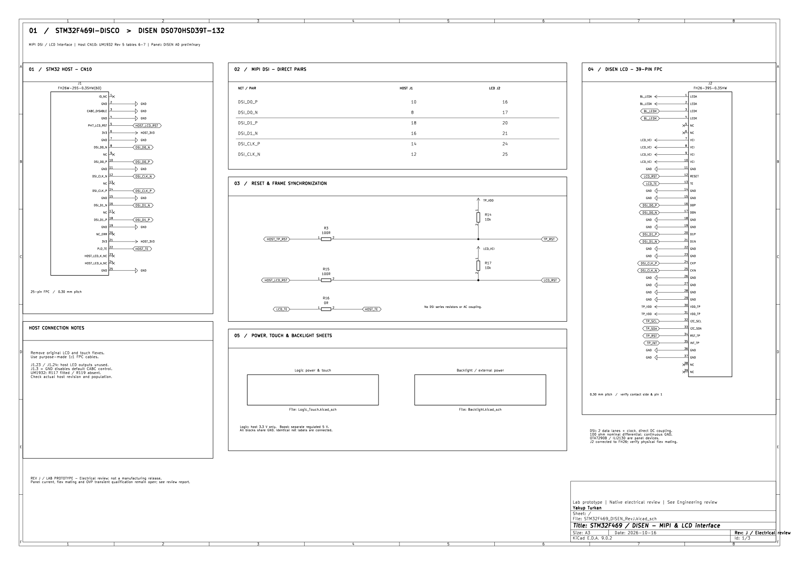

# STM32F469I-DISCO / DISEN — Şematik Rev J

**Güncel teslim: elektriksel ve görsel şematik revizyonu.** Gerçek KiCad dosyaları düzenlendi; ERC sonucu **0 hata, 3 açıklanmış uyarı**. PCB ve yazılım bu aşamada değiştirilmedi.

- [Tüm Rev J dosyalarını indir — ZIP](STM32F469_DISEN_RevJ_Schematic_Review.zip)
- [Revize şematik — PDF](Schematic_RevJ_Review/PDF/STM32F469_DISEN_RevJ_Schematic.pdf)
- [Mühendislik incelemesi — PDF](Schematic_RevJ_Review/PDF/Engineering_Review_RevJ.pdf)
- [Düzenlenebilir KiCad projesi](Schematic_RevJ_Review/Project/) · [BOM](Schematic_RevJ_Review/BOM/BOM_RevJ.csv)
- [Açılış ve değişiklik özeti](Schematic_RevJ_Review/README_TR.md) · [ERC](Schematic_RevJ_Review/Verification/ERC_RevJ.txt)

ZIP sayfasında **Download raw file** düğmesini kullanın. Arşivi tamamen çıkarıp `Schematic_RevJ_Review/Project/STM32F469_DISEN_RevJ.kicad_pro` dosyasını KiCad 9 ile açın.

U2.6 ve C13.1 beslemeleri `HOST_3V3` yerine `BL_POWER` hattına taşındı. J2, panelin önerdiği FH26 temel parça adına düzeltildi; pad geometrisi korundu. 52 güç portu güç sembolüne dönüştürüldü; farklı beslemeler birleştirilmedi. 49 fiziksel komponent ve 57 net korundu. Özgün yükleme arşivi teslim içinde değiştirilmeden saklandı.

**Üretim onayı değildir.** U2 birincil veri sayfası/OVP geçici rejimi, panel akım bütçesi, touch besleme toleransı, reset zamanlaması ve fiziksel FPC eşleşmesi için açık doğrulamalar rapordadır. Önceki PCB'ler Rev J'ye geçişte ECO gerektirir; eski Gerber'ler Rev J üretim dosyası değildir.

## Korunan Rev I arşivleri

- [Önceki Rev I routing ZIP](STM32F469_RevI_Routed_Review.zip) · [Routing incelemesi](PCB_Routing_Review/Routing_Review_TR.pdf)
- [Onaylanan placement P1](PCB_Placement_Review/Placement_Review.pdf) · [Placement ZIP](STM32F469_RevI_Placement_Review.zip)
- [Önceki şematik PDF](STM32F469_RevI_Professional.pdf) · [KiCad arşivi](STM32F469_RevI_Professional_KiCad.zip)

Bu tarihsel dosyalar değiştirilmedi; Rev J'nin iki besleme ECO'sunu ve J2 kimlik düzeltmesini içermezler.
